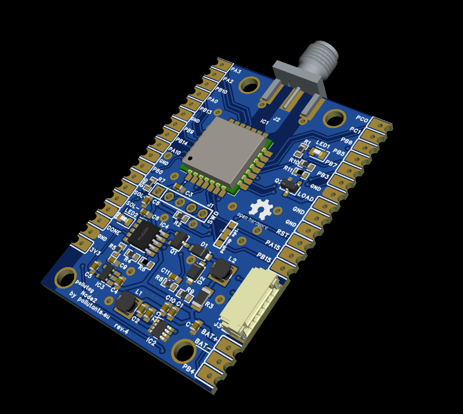

# Pollutag Node2
The LoraWAN node for air quatity monitoring based on STM32WLE and SEN54 Sensirion sensor
868 Mhz LoRaWAN node for continuous air quality monitoring. The node operates autonomously and support remote commands via downlinks.
SEN54 connected via I2C2 interface.
1. LaraWAN node based on STM32WLE MCU (LORA-E5), easy to integrate monitoring and control node (air quality monitoring, garden, intelligent home. etc.)
2. You may connect load remotely by downlinks - via AO3400A transistor (on board)
3. New Sensirion SEN54 sensor optimized
4. MPPT and Li-Ion battery charger for power from 5V++ cheap solar panels.
5. Sleep current as low as 0.9 mA
6. 10+ years of autonomity with cheap 2W solar panel and standard 1850 Li-Ion battery
7. More than 2 weeks work autonomity from fully charged 3500mA  Li-Ion battery
8. Ideal for sensor.community integration over LoRaWAN IoT, like TTN and Helium, no internet connection from your side needed!
9. Full fledged with routed test points - easy to solder - easy to add functionality (inputs, outputs, interfaces etc.)

## How the node works (firmware v1.4.1)
Measurement cycle (default every 30 minutes, set by downlink `02`):

| Time | Action |
|---|---|
| 0 s | SEN54 power on (skipped while the battery level byte is 143 or lower) |
| 1 s | Sensor reset, VOC algorithm state restored, measurement started |
| 31-60 s | PM: 30 s start-up, then one sample per second averaged over 30 s (Sensirion "Reduced Power Operation SEN5x" recommendation). VOC, temperature and humidity are taken from the last sample |
| 61 s | Result ready; uplink sent if no uplink period is set |
| 62 s | VOC algorithm state saved, measurement stopped |
| 63 s | SEN54 power off |

The sensor is powered for 63 s per cycle (about 70 mA while measuring).
VOC note: the SEN54 VOC index learns its baseline during continuous operation. Because the sensor is
powered off between measurements, the VOC value is only a rough, short-term indicator. The VOC
algorithm state is saved before power-off and restored at power-up to reduce the effect.

Uplinks are unconfirmed, with ADR on. By default one uplink is sent after each measurement; with
downlink `03` the node sends instead on its own timer (each uplink carries the latest measurement).
If the duty-cycle limit does not allow sending yet, the LoRaWAN stack queues the uplink and sends it
as soon as allowed. Settings made by downlink are not stored: after a reset the defaults apply again.

## Downlink commands supported
All commands on Port 2, two bytes `[command, value]` (except reset):

| Downlink | Command | Value |
|---|---|---|
| `01 00` / `01 01` | LED / load output off / on | This LED is enhanced with a FET transistor, so you may connect some load to be switched ON/OFF (see the schematic in PCB folder) |
| `02 XX` | Measuring period | XX minutes (hex). `00` = measuring off, `01` is raised to the 2 minute minimum. Default 30 min (`02 1E`) |
| `03 XX` | Uplink period | XX minutes (hex), minimum 1. Uplinks are then sent only every XX minutes. `00` = one uplink after each measurement (default) |
| `FF FF FF FF FF FF` | Reset the device | |

Examples: `02 3C` measure every 60 min, `03 05` send every 5 min, `01 01` LED on.

Downlink payload encoder example:
```js
function Encoder(measurements, port) {
    // LED on/off
    if (measurements.LED_ON !== undefined) return [0x01, measurements.LED_ON.value ? 1 : 0];
    // measuring period, minutes (0 = off)
    if (measurements.MEASURE_MIN !== undefined) return [0x02, measurements.MEASURE_MIN.value & 0xFF];
    // uplink period, minutes (0 = after each measurement)
    if (measurements.UPLINK_MIN !== undefined) return [0x03, measurements.UPLINK_MIN.value & 0xFF];
    return [];
}
```
## Uplink
The node uplink data packet (Port 2) contains 14 payload bytes with the following data: PM1 concentration,
PM2.5 concentration, PM10 concentration (30 s averages), temperature, humidity, volatile organic compounds
index (VOC), battery level related to volts, status of LED output.

| Bytes | Value | Encoding | Invalid / no data |
|---|---|---|---|
| 0-1 | PM1.0 | ug/m3 x10, big endian | `FF FF` |
| 2-3 | PM2.5 | ug/m3 x10, big endian | `FF FF` |
| 4-5 | PM10 | ug/m3 x10, big endian | `FF FF` |
| 6-7 | Temperature | byte6 + byte7/100 - 100 [degC] | `FF FF` |
| 8-9 | Humidity | byte8 + byte9/100 [%RH] | `FF FF` |
| 10-11 | VOC index | x10, big endian | `FF FF` |
| 12 | Battery level | x 0.0238 = volts | |
| 13 | LED output | 0 = off, 1 = on | |

Invalid values are sent when the sensor did not answer or had no data (for example while the battery is
too low to power it).

Decoder for payload on server side (uplink):
```js
 function Decoder(bytes, port, uplink_info) {
    var decoded = {};
    function u16(i) { return bytes[i]*256 + bytes[i+1]; }
    function invalid(i) { return bytes[i] === 0xFF && bytes[i+1] === 0xFF; }
    decoded.PM1   = invalid(0) ? null : (u16(0)/10.0).toFixed(2);
    decoded.PM2_5 = invalid(2) ? null : (u16(2)/10.0).toFixed(2);
    decoded.PM10  = invalid(4) ? null : (u16(4)/10.0).toFixed(2);
    decoded.T     = invalid(6) ? null : (-100.0 + bytes[6] + bytes[7]/100.0).toFixed(2);
    decoded.RH    = invalid(8) ? null : (bytes[8] + bytes[9]/100).toFixed(2);
    decoded.VOC   = invalid(10) ? null : (u16(10)/10.0).toFixed(2);
    decoded.Battery = (bytes[12]*0.0238).toFixed(2);//battery , volts
    decoded.LEDON = bytes[13];
    decoded.RSSI = normalizedPayload.gateways[0].rssi.toFixed(0);
    decoded.SNR = normalizedPayload.gateways[0].snr.toFixed(0);
    decoded.FREQUENCY = normalizedPayload.frequency;
    return decoded;
 }
```

## Open and build
1. Install STM32CubeIDE (the `.ioc` was saved with STM32CubeMX 6.15, firmware package STM32Cube FW_WL V1.3.1).
2. *File > Import > General > Existing Projects into Workspace*, select the `FW` folder. The project is called `pollutag_node2`.
3. Build: *Debug* (no optimisation, for debugging) or *Release* (optimised, for deployment).
   All sources, include paths and the linker script are relative to the project folder, so no setup is needed.
4. Flash / debug with the `pollutag_node2` launch configuration (ST-LINK, connect under reset).

Notes:
- The firmware package FW_WL V1.3.1 is only needed to regenerate code from the `.ioc`; building works without it.
- Application code lives in `FW/Core/Src/app_sensor.c` (sensor and measurement cycle) and `FW/LoRaWAN/App/lora_app.c`
  (uplink payload, downlinks), inside the CubeMX `USER CODE` sections so regenerating keeps it.
- The last 4 KB of flash (0x0803F000) hold the LoRaWAN session and are reserved in `FW/STM32WLE5JCIX_FLASH.ld`.
- Enter the LoRaWAN credentials of your device in `FW/LoRaWAN/App/lorawan_credentials.h` before building, see [LoRaWAN credentials](#lorawan-credentials).

## Preparation
Originally LORA-E5 (Wio)  modules came pre-programmed with AT-command enabled stack, working like a LoRaWAN modem.
To use the core MCU for this node it is needed first to erase the chip and prepare the project for proper comissioning. You may use commissioning identificators already pre-programmed into the chip by Seeed studio, or generate the new via TTN/ Helium console.
To erase chip connect it via ST-LINK **under reset** (you need to short RESET pin (J1, pin 5) of the MCU to the ground before you press "Connect" button in STM32CubeProgrammer).


After you successfully connected the MCU, it need to be reprogrammed Read protection Option Byte to AA (no protection)


After completing this process, the chip should be successfully cleaned.


## LoRaWAN credentials
The keys are **not** taken from the `.ioc` (it keeps zeros). Each device has its own small file
`FW/LoRaWAN/App/lorawan_credentials.h`, which overrides the CubeMX values and survives code regeneration:

```c
#define LORAWAN_DEVICE_EUI    00,00,00,00,00,00,00,00                          // 8 bytes
#define LORAWAN_JOIN_EUI      00,00,00,00,00,00,00,00                          // 8 bytes (AppEUI)
#define LORAWAN_APP_KEY       00,00,00,00,00,00,00,00,00,00,00,00,00,00,00,00  // 16 bytes
```

1. Copy `FW/LoRaWAN/App/lorawan_credentials_template.h` to `FW/LoRaWAN/App/lorawan_credentials.h`
   (if the file is missing the build stops with a message saying so).
2. Enter the values from your network console (TTN, Helium, ChirpStack...) as comma separated hex
   bytes, MSB first, exactly as the console shows them.
3. Build and flash. At boot the node prints the `DevEUI` and `JoinEUI` it uses on the debug UART (115200 baud).

Options:
- `LORAWAN_DEVICE_EUI` all `00`: the DevEUI is derived from the MCU unique ID. Read it from the boot log
  and register the device with that DevEUI in the network console.
- `LORAWAN_JOIN_EUI` may be left all `00` for networks that accept it (useful if you plan to move to a
  different LoRaWAN network later: register the node on the new network console, reset the node, then
  delete it on the old console and reset again).
- You may also reuse the identifiers pre-programmed by Seeed Studio (read them out with the AT commands
  before erasing the chip).

`lorawan_credentials.h` is device specific and secret: do not share or commit it (it is listed in
`FW/.gitignore`); share `lorawan_credentials_template.h` instead.

Hackaday project: [LINK](https://hackaday.io/project/198348-pollutagnode2-air-quality-monitor-lorawan)

OSHWLab STD project: [LINK](https://oshwlab.com/pinelab/pollutagnode2-lorawan-node-air-quality-monitor)

OSHWLab PRO poject: [LINK](https://oshwlab.com/pinelab/pollutag2)

Pollutants.eu: [LINK](https://pollutants.eu/index.php/component/search/?searchword=pollutag&searchphrase=all&Itemid=121)

